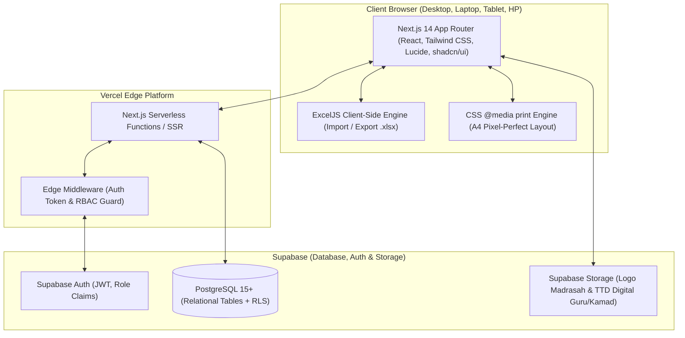
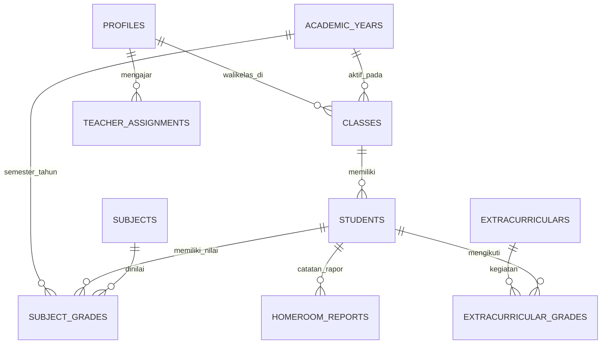
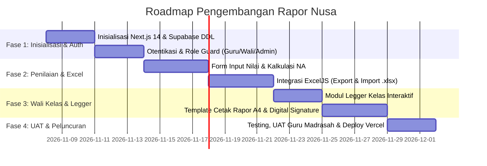

# Product Requirement Document (PRD)
## Project: Rapor Nusa (Aplikasi Rapor MA Ma'arif Nurus Salam)

---

| **Dokumen Versi** | 1.0.0 |
| **Status** | Approved for Development |
| **Target Institusi** | MA Ma'arif Nurus Salam (Yayasan Nurul Ulum Blitar) |
| **Kepala Madrasah** | M. Zen Pamuji, S.Pd. |
| **Alamat Institusi** | Jl. Diponegoro No. 105 Kedungbunder, Sutojayan, Blitar, Jawa Timur |
| **Tech Stack** | Next.js 14+ (App Router), TypeScript, Tailwind CSS, Supabase, Vercel, GitHub |
| **Legacy Source** | Google Sheets DB (`1a-ij6FinZEBcCn0IcNTQ5nDzDRhoTjD87TN1G8pIK5I`) & Google Apps Script |

---

## 1. Executive Summary & Problem Statement

### 1.1 Latar Belakang
Sebelumnya MA Ma'arif Nurus Salam mengelola penilaian rapor menggunakan Google Sheets dan Google Apps Script (GAS) berbasis Web App. Walaupun fungsional, sistem lama memiliki keterbatasan:
1. **Skalabilitas & Konkurensi**: Pembacaan dan penulisan batch di Google Sheets sering mengalami *quota throttling*, *timeout* (eksekusi maks 6 menit), dan lambat saat seluruh guru menginput nilai secara bersamaan di akhir semester.
2. **Keamanan & Autentikasi**: Penyimpanan kata sandi dalam plaintext di lembar sheet `Users` dan ketiadaan sistem sesi (JWT / cookie terenkripsi).
3. **Fleksibilitas UI/UX**: Keterbatasan iframe pada Google Apps Script membuat tampilan mobile kurang ergonomis, serta pengelolaan state yang rentan *race condition*.
4. **Kerapian Format Cetak**: Format cetak legger dan rapor individual membutuhkan standar tipografi resmi madrasah, presisi cetak A4 portrait/landscape tanpa jeda halaman (*page break*) terpotong.

### 1.2 Tujuan Produk (Product Goals)
Membangun **Rapor Nusa**, sistem web aplikasi manajemen rapor madrasah modern, cepat, aman, dan responsif dengan:
- Arsitektur berbasis **Next.js 14 (App Router)** dan **Supabase (PostgreSQL + Auth + Storage + Row Level Security)**.
- Dukungan alur kerja modular untuk:
  - **Guru Mata Pelajaran** (Input nilai formatif/lingkup materi, STS, SAS, catatan mapel, serta impor/ekspor Excel).
  - **Guru Pembina Ekstrakurikuler** (Penilaian predikat dan capaian kegiatan ekstra).
  - **Wali Kelas** (Presensi, catatan karakter, rekap legger satu kelas, verifikasi ttd, serta cetak rapor per siswa).
  - **Kepala Madrasah & Administrator** (Manajemen data master, monitoring progres penginputan, cetak arsip rapor).
- *Zero-latency optimistic UI*, kompatibilitas impor-ekspor file Excel offline (.xlsx), serta dukungan cetak langsung / export PDF yang presisi.

---

## 2. User Persona & Role-Based Access Control (RBAC)

### 2.1 Matriks Peran Pengguna

| Role | Kode Role | Wewenang & Hak Akses |
|---|---|---|
| **Administrator / Operator** | `admin` | Akses penuh: Kelola Tahun Ajaran, Kelas, Siswa, Mapel, Ekskul, Akun Pengguna, Penugasan Guru, Pengaturan Kop/Madrasah. |
| **Guru Mata Pelajaran** | `guru` | Menginput/mengedit nilai harian/formatif (LM 1-4), STS, SAS, dan Catatan Mapel untuk kelas & mata pelajaran yang diampu. Export/Import Excel nilai. |
| **Wali Kelas** | `wali_kelas` | Menginput absensi (Sakit, Izin, Alpha), Catatan Wali Kelas, Keputusan Kenaikan/Kelulusan. Melihat & mengunduh Legger Kelas. Mencetak Rapor Per Siswa. Upload tanda tangan digital. |
| **Guru & Wali Kelas** | `guru_walikelas` | Menggabungkan fungsi `guru` pada mata pelajarannya dan fungsi `wali_kelas` pada kelas binaannya. |
| **Guru Ekstrakurikuler** | `ekstra` | Menginput nilai predikat dan deskripsi capaian ekstrakurikuler yang dibina untuk seluruh siswa peserta. |
| **Kepala Madrasah** | `kamad` | Memantau statistik kelengkapan nilai madrasah, melihat legger seluruh kelas, menyetujui/validasi rapor, membubuhkan stempel/tanda tangan digital. |

### 2.2 Row Level Security (RLS) Policy Supabase
- `subject_grades`: Hanya bisa diubah oleh guru yang ditugaskan pada kelas dan mapel terkait, atau `admin`.
- `homeroom_reports`: Hanya bisa diubah oleh wali kelas yang ditugaskan pada kelas terkait, atau `admin`.
- `extracurricular_grades`: Hanya bisa diubah oleh pembina ekskul terkait atau `admin`.
- `students`, `subjects`, `classes`: Read-only untuk guru/wali kelas; Full access untuk admin.

---

## 3. Product Architecture & Tech Stack



### 3.1 Stack Spesifikasi Teknis
- **Frontend Core**: Next.js 14.2+ (App Router), React 18/19, TypeScript 5.x.
- **Styling & UI Components**: Tailwind CSS, Radix UI primitives / shadcn/ui, Lucide React (ikon modern).
- **State & Data Fetching**: TanStack Table v8 (untuk tabel nilai reaktif & fleksibel), SWR / React Query atau Server Actions dengan revalidasi instan.
- **Form & Validasi**: React Hook Form, Zod.
- **Excel Spreadsheet Handling**: `exceljs` untuk pemrosesan file Excel native browser, menjaga proteksi sel (NIS/Nama) dan style kustom.
- **Backend / Database**: Supabase PostgreSQL dengan skema relasional kuat, trigger otomatis untuk `updated_at`, dan foreign keys berintegritas.
- **Object Storage**: Supabase Storage (`bucket: assets-rapor`) untuk logo madrasah, barcode validasi, dan tanda tangan digital.
- **Deployment & CI/CD**:
  - Version Control: GitHub (`main` branch & feature branch).
  - Production Hosting: Vercel dengan otomatisasi deployment & branch preview.
  - Environment: Local development (`npm run dev`) disinkronkan dengan Supabase Local CLI / Cloud.

---

## 4. Supabase Database Schema (DDL)



### 4.1 SQL Migration Script (Supabase DDL)

```sql
-- 1. EXTENSIONS
CREATE EXTENSION IF NOT EXISTS "uuid-ossp";

-- 2. TIPE ENUM
CREATE TYPE user_role AS ENUM ('admin', 'guru', 'wali_kelas', 'guru_walikelas', 'ekstra', 'kamad');
CREATE TYPE semester_enum AS ENUM ('1', '2');
CREATE TYPE predikat_enum AS ENUM ('A', 'B', 'C', 'D');
CREATE TYPE ekskul_predikat_enum AS ENUM ('Sangat Baik', 'Baik', 'Cukup', 'Kurang');
CREATE TYPE keputusan_enum AS ENUM ('-', 'Naik Kelas', 'Tinggal Kelas', 'Lulus', 'Tidak Lulus');

-- 3. PROFIL PENGGUNA (Terhubung dengan auth.users Supabase)
CREATE TABLE public.profiles (
    id UUID PRIMARY KEY REFERENCES auth.users(id) ON DELETE CASCADE,
    username VARCHAR(50) UNIQUE NOT NULL,
    nama_lengkap VARCHAR(150) NOT NULL,
    nip VARCHAR(50) DEFAULT '-',
    role user_role DEFAULT 'guru',
    kelas_diampu VARCHAR(50) DEFAULT '-', -- Misal: 'X-A', 'XI-IPA'
    ttd_url TEXT,
    is_active BOOLEAN DEFAULT TRUE,
    created_at TIMESTAMPTZ DEFAULT NOW(),
    updated_at TIMESTAMPTZ DEFAULT NOW()
);

-- 4. TAHUN AJARAN & SEMESTER
CREATE TABLE public.academic_years (
    id UUID PRIMARY KEY DEFAULT uuid_generate_v4(),
    tahun VARCHAR(20) NOT NULL, -- Contoh: '2024/2025'
    semester semester_enum NOT NULL, -- '1' (Gasal), '2' (Genap)
    is_active BOOLEAN DEFAULT FALSE,
    tanggal_rapor DATE,
    tempat_penerbitan VARCHAR(100) DEFAULT 'Blitar',
    created_at TIMESTAMPTZ DEFAULT NOW(),
    UNIQUE(tahun, semester)
);

-- 5. KELAS
CREATE TABLE public.classes (
    id UUID PRIMARY KEY DEFAULT uuid_generate_v4(),
    nama_kelas VARCHAR(50) NOT NULL UNIQUE, -- Contoh: 'X-A', 'XI-IPA', 'XII-IPS'
    tingkat INT NOT NULL CHECK (tingkat IN (10, 11, 12)),
    wali_kelas_id UUID REFERENCES public.profiles(id) ON DELETE SET NULL,
    created_at TIMESTAMPTZ DEFAULT NOW()
);

-- 6. DATA SISWA
CREATE TABLE public.students (
    id UUID PRIMARY KEY DEFAULT uuid_generate_v4(),
    nis VARCHAR(50) NOT NULL UNIQUE,
    nisn VARCHAR(50) UNIQUE,
    nama_lengkap VARCHAR(150) NOT NULL,
    jenis_kelamin VARCHAR(10) CHECK (jenis_kelamin IN ('L', 'P')),
    class_id UUID REFERENCES public.classes(id) ON DELETE SET NULL,
    status VARCHAR(20) DEFAULT 'aktif', -- 'aktif', 'mutasi', 'lulus'
    created_at TIMESTAMPTZ DEFAULT NOW()
);

-- 7. MATA PELAJARAN
CREATE TABLE public.subjects (
    id UUID PRIMARY KEY DEFAULT uuid_generate_v4(),
    kode_mapel VARCHAR(50) NOT NULL UNIQUE, -- Contoh: 'PAI', 'MAT-W', 'BIO'
    nama_mapel VARCHAR(150) NOT NULL,
    kelompok VARCHAR(50) DEFAULT 'Umum', -- 'Muatan Nasional', 'Peminatan', 'Muatan Lokal'
    urutan INT DEFAULT 1,
    created_at TIMESTAMPTZ DEFAULT NOW()
);

-- 8. PENUGASAN GURU KE MAPEL & KELAS
CREATE TABLE public.teacher_assignments (
    id UUID PRIMARY KEY DEFAULT uuid_generate_v4(),
    guru_id UUID NOT NULL REFERENCES public.profiles(id) ON DELETE CASCADE,
    subject_id UUID NOT NULL REFERENCES public.subjects(id) ON DELETE CASCADE,
    class_id UUID NOT NULL REFERENCES public.classes(id) ON DELETE CASCADE,
    academic_year_id UUID NOT NULL REFERENCES public.academic_years(id) ON DELETE CASCADE,
    UNIQUE(guru_id, subject_id, class_id, academic_year_id)
);

-- 9. DAFTAR EKSTRAKURIKULER
CREATE TABLE public.extracurriculars (
    id UUID PRIMARY KEY DEFAULT uuid_generate_v4(),
    nama_ekskul VARCHAR(100) NOT NULL UNIQUE,
    pembina_id UUID REFERENCES public.profiles(id) ON DELETE SET NULL,
    deskripsi TEXT
);

-- 10. NILAI MATA PELAJARAN (INTRAKURIKULER)
CREATE TABLE public.subject_grades (
    id UUID PRIMARY KEY DEFAULT uuid_generate_v4(),
    academic_year_id UUID NOT NULL REFERENCES public.academic_years(id) ON DELETE CASCADE,
    student_id UUID NOT NULL REFERENCES public.students(id) ON DELETE CASCADE,
    subject_id UUID NOT NULL REFERENCES public.subjects(id) ON DELETE CASCADE,
    
    -- Lingkup Materi (Judul & Nilai)
    materi_1 VARCHAR(255),
    nilai_harian_1 NUMERIC(5,2) DEFAULT 0,
    materi_2 VARCHAR(255),
    nilai_harian_2 NUMERIC(5,2) DEFAULT 0,
    materi_3 VARCHAR(255),
    nilai_harian_3 NUMERIC(5,2) DEFAULT 0,
    materi_4 VARCHAR(255),
    nilai_harian_4 NUMERIC(5,2) DEFAULT 0,
    
    -- Ujian
    nilai_uts NUMERIC(5,2) DEFAULT 0, -- STS
    nilai_uas NUMERIC(5,2) DEFAULT 0, -- SAS
    
    -- Nilai Akhir & Predikat
    nilai_akhir NUMERIC(5,2) DEFAULT 0,
    predikat predikat_enum DEFAULT 'C',
    catatan_mapel TEXT,
    
    updated_by UUID REFERENCES public.profiles(id),
    updated_at TIMESTAMPTZ DEFAULT NOW(),
    UNIQUE(academic_year_id, student_id, subject_id)
);

-- 11. NILAI EKSTRAKURIKULER
CREATE TABLE public.extracurricular_grades (
    id UUID PRIMARY KEY DEFAULT uuid_generate_v4(),
    academic_year_id UUID NOT NULL REFERENCES public.academic_years(id) ON DELETE CASCADE,
    student_id UUID NOT NULL REFERENCES public.students(id) ON DELETE CASCADE,
    extracurricular_id UUID NOT NULL REFERENCES public.extracurriculars(id) ON DELETE CASCADE,
    predikat ekskul_predikat_enum DEFAULT 'Baik',
    keterangan TEXT,
    updated_at TIMESTAMPTZ DEFAULT NOW(),
    UNIQUE(academic_year_id, student_id, extracurricular_id)
);

-- 12. RAPOR WALI KELAS (ABSENSI & KEPUTUSAN)
CREATE TABLE public.homeroom_reports (
    id UUID PRIMARY KEY DEFAULT uuid_generate_v4(),
    academic_year_id UUID NOT NULL REFERENCES public.academic_years(id) ON DELETE CASCADE,
    student_id UUID NOT NULL REFERENCES public.students(id) ON DELETE CASCADE,
    sakit INT DEFAULT 0,
    izin INT DEFAULT 0,
    tanpa_keterangan INT DEFAULT 0,
    catatan_wali TEXT,
    keputusan keputusan_enum DEFAULT '-',
    updated_at TIMESTAMPTZ DEFAULT NOW(),
    UNIQUE(academic_year_id, student_id)
);

-- 13. KONFIGURASI PROFIL LEMBAGA
CREATE TABLE public.school_config (
    id UUID PRIMARY KEY DEFAULT uuid_generate_v4(),
    nama_yayasan VARCHAR(200) DEFAULT 'YAYASAN NURUL ULUM BLITAR',
    nomor_sk_kemenkumham VARCHAR(200) DEFAULT 'AHU-0002160.AH.01.04. Tahun 2017',
    nama_madrasah VARCHAR(200) DEFAULT 'MA MA''ARIF NURUS SALAM',
    alamat VARCHAR(255) DEFAULT 'Jalan Diponegoro no. 105 Kedungbunder, Sutojayan, Blitar, Jawa Timur',
    kepala_madrasah VARCHAR(150) DEFAULT 'M. Zen Pamuji, S.Pd.',
    nip_kepala VARCHAR(50) DEFAULT '-',
    logo_kemenag_url TEXT,
    logo_madrasah_url TEXT,
    stempel_url TEXT
);
```

---

## 5. Rumus & Algoritma Kalkulasi Nilai

Mengikuti standar pada kode sumber aplikasi:

1. **Rata-rata Nilai Formatif (Harian / Lingkup Materi)**:
   $$\text{Avg Harian} = \frac{\sum_{i=1}^{n} \text{nilai\_harian}_i}{n}$$
   *(Jika belum ditentukan, pembagi default adalah 4 atau jumlah materi yang diinput).*

2. **Nilai Akhir (NA)**:
   $$NA = \text{round}\big((\text{Avg Harian} \times 0.40) + (\text{Nilai UTS / STS} \times 0.30) + (\text{Nilai UAS / SAS} \times 0.30)\big)$$

3. **Interval Predikat**:
   $$\text{Predikat} = \begin{cases}
   \text{'A'} & \text{jika } NA \ge 90 \\
   \text{'B'} & \text{jika } 80 \le NA < 90 \\
   \text{'C'} & \text{jika } 70 \le NA < 80 \\
   \text{'D'} & \text{jika } NA < 70
   \end{cases}$$

---

## 6. Fitur & Spesifikasi Fungsional

### 6.1 Modul Otentikasi & Navigasi
- Login multi-role menggunakan email/username & password via Supabase Auth.
- Deteksi otomatis peran pengguna setelah login:
  - Redireksi dashboard spesifik guru mapel / wali kelas / admin.
  - Sapaan nama guru dan penanda kelas ampuannya.
  - Sesi JWT aman (HttpOnly cookies melalui middleware Next.js).

### 6.2 Filter Interaktif & Grid Pengisian Nilai (TanStack Table)
- Filter dropdown dinamis:
  - Tipe Penilaian (`Mata Pelajaran`, `Ekstrakurikuler`, `Rapor Wali Kelas`).
  - Tahun Ajaran & Semester (otomatis terisi yang aktif).
  - Pilihan Kelas (otomatis terpilih jika guru merupakan wali kelas).
  - Pilihan Mata Pelajaran / Ekstrakurikuler.
- **Tabel Nilai Intrakurikuler**:
  - Kolom Judul Materi di header baris atas (Materi 1 - 4) yang dapat diisi sekaligus untuk seluruh siswa di kelas tersebut.
  - Input angka dinamis per baris (Harian 1-4, STS, SAS) dengan kalkulasi otomatis realtime di sisi client sebelum disimpan.
  - Tombol **Simpan Semua Data** (Batch Upsert ke Supabase).
- **Tabel Nilai Ekstrakurikuler**:
  - Pilihan siswa via *checkbox* (hanya siswa yang mengikuti ekskul tersebut yang disimpan).
  - Dropdown Predikat (`Sangat Baik`, `Baik`, `Cukup`, `Kurang`).
  - Input deskripsi capaian kegiatan.
- **Tabel Rapor Wali Kelas**:
  - Input kehadiran (Sakit, Izin, Alpha).
  - Input Catatan Karakter / Wali Kelas.
  - Dropdown Keputusan Kenaikan (`-`, `Naik Kelas`, `Tinggal Kelas`, `Lulus`).

### 6.3 Fitur Ekspor & Impor Excel (.xlsx) Offline
- Menggunakan `exceljs` yang dioptimasi di sisi browser.
- **Unduh Template**:
  - Header otomatis sesuai kelas dan mapel yang dipilih.
  - Kolom NIS dan Nama Siswa diberi format visual proteksi (*locked styling* / warna abu-abu) agar guru tidak sengaja mengubah data master.
- **Unggah Excel**:
  - Validasi kecocokan NIS sebelum membaca data.
  - Ekstraksi otomatis judul materi dari baris ke-2 dan data nilai siswa dari baris ke-4 ke atas.
  - Data langsung terisi ke dalam form tabel web untuk diperiksa guru sebelum disimpan ke database.

### 6.4 Modul Wali Kelas (Legger & Cetak Rapor)
1. **Legger Nilai Kelas**:
   - Menampilkan matriks rekapitulasi nilai seluruh mata pelajaran untuk satu kelas.
   - Kolom Presensi (S, I, A) dan Catatan.
   - Tombol **Cetak / Simpan PDF Legger** (Format A4 Landscape).
2. **Cetak Rapor Per Siswa**:
   - Pilihan siswa berbasis dropdown.
   - Upload tanda tangan digital Wali Kelas (PNG/JPG transparan) atau otomatis mengambil dari profil guru.
   - Layout dokumen resmi mengacu pada format madrasah:
     - **Kop Surat**: *YAYASAN NURUL ULUM BLITAR - MA MA'ARIF NURUS SALAM*.
     - **Tabel Identitas**: NISN/NIS, Nama Siswa, Kelas, Semester, Tahun Pelajaran.
     - **Tabel A. Capaian Intrakurikuler**: Mata Pelajaran, Nilai Capaian (LM, STS, SAS), Lingkup Materi.
     - **Tabel B. Capaian Ekstrakurikuler**: No, Ekstrakurikuler, Nilai, Keterangan.
     - **Tabel C. Presensi Kehadiran**: Sakit, Izin, Tanpa Keterangan (satuan Hari).
     - **Bagian D. Catatan Wali Kelas**: Kotak border keterangan karakter & evaluasi belajar.
     - **Bagian Tanda Tangan Tiga Pihak**:
       1. Orang Tua / Wali Siswa.
       2. Kepala Madrasah (**M. Zen Pamuji, S.Pd.**).
       3. Wali Kelas (disertai tanda tangan digital).
   - Tombol **Cetak Rapor / PDF** dengan aturan CSS print:
     ```css
     @media print {
       @page { size: A4 portrait; margin: 10mm 15mm; }
       body { -webkit-print-color-adjust: exact; print-color-adjust: exact; }
       .no-print { display: none !important; }
     }
     ```

---

## 7. Desain Arsitektur Folder Proyek (Next.js 14)

```text
rapor-nusa/
├── .github/
│   └── workflows/
│       └── deploy.yml            # CI/CD lint & test pipeline
├── public/
│   ├── images/
│   │   ├── logo-kemenag.png
│   │   └── logo-madrasah.png
├── src/
│   ├── app/
│   │   ├── (auth)/
│   │   │   └── login/
│   │   │       └── page.tsx      # Tampilan login modern
│   │   ├── (dashboard)/
│   │   │   ├── layout.tsx        # Layout dashboard, navbar & sidebar
│   │   │   ├── page.tsx          # Beranda statistik & progres input
│   │   │   ├── nilai/
│   │   │   │   └── page.tsx      # Form input & batch table nilai
│   │   │   ├── legger/
│   │   │   │   └── page.tsx      # Legger kelas & print preview
│   │   │   ├── cetak-rapor/
│   │   │   │   └── page.tsx      # Cetak lembar rapor per siswa
│   │   │   └── settings/
│   │   │       └── page.tsx      # Pengaturan akun, TTD, & master data
│   │   ├── api/                  # Route handlers untuk export/import
│   │   ├── globals.css           # Styling dasar Tailwind & @media print
│   │   └── layout.tsx
│   ├── components/
│   │   ├── ui/                   # Reusable shadcn/ui components (Button, Modal, Select)
│   │   ├── nilai/
│   │   │   ├── TableMapel.tsx
│   │   │   ├── TableEkskul.tsx
│   │   │   └── TableWali.tsx
│   │   ├── legger/
│   │   │   └── LeggerTable.tsx
│   │   └── print/
│   │       ├── RaporTemplate.tsx # Template cetak resmi A4
│   │       └── KopMadrasah.tsx   # Header resmi Yayasan Nurul Ulum
│   ├── lib/
│   │   ├── supabase/
│   │   │   ├── client.ts         # Supabase browser client
│   │   │   ├── server.ts         # Supabase SSR server client
│   │   │   └── middleware.ts     # Session refresh & route guard
│   │   ├── excel/
│   │   │   ├── exportMapel.ts    # Generator .xlsx ExcelJS
│   │   │   └── parseExcel.ts     # Parser unggahan file .xlsx
│   │   └── utils.ts
│   └── types/
│       └── index.ts              # Interface database & payload
├── supabase/
│   ├── migrations/
│   │   └── 20260101_init_schema.sql
│   └── seed.sql                  # Data awal siswa, guru, mapel
├── .env.example
├── next.config.mjs
├── package.json
├── tailwind.config.ts
└── tsconfig.json
```

---

## 8. Panduan Ekosistem Deployment (Lokal, GitHub, Vercel, Supabase)

### 8.1 Setup Supabase
1. Buat proyek baru di [Supabase Dashboard](https://supabase.com).
2. Buka **SQL Editor**, eksekusi file migrasi `20260101_init_schema.sql`.
3. Buka **Storage**, buat bucket baru `assets-rapor` dengan opsi **Public**.
4. Salin kredensial proyek dari **Project Settings > API**:
   - `Project URL` -> `NEXT_PUBLIC_SUPABASE_URL`
   - `Anon / Public Key` -> `NEXT_PUBLIC_SUPABASE_ANON_KEY`
   - `service_role key` -> `SUPABASE_SERVICE_ROLE_KEY` (khusus server-side jika diperlukan).

### 8.2 Setup Repositori GitHub
1. Inisialisasi git di folder lokal:
   ```bash
   git init
   git add .
   git commit -m "feat: initial commit Rapor Nusa PRD & architecture"
   ```
2. Hubungkan ke repositori GitHub:
   ```bash
   git branch -M main
   git remote add origin https://github.com/<username>/rapor-nusa.git
   git push -u origin main
   ```

### 8.3 Setup Deployment di Vercel
1. Masuk ke [Vercel Dashboard](https://vercel.com) dan pilih **Add New Project**.
2. Hubungkan akun GitHub dan pilih repositori `rapor-nusa`.
3. Di bagian **Environment Variables**, tambahkan:
   - `NEXT_PUBLIC_SUPABASE_URL`
   - `NEXT_PUBLIC_SUPABASE_ANON_KEY`
   - `NEXT_PUBLIC_BASE_URL`
4. Klik **Deploy**. Setiap *commit* atau *pull request* ke branch `main` di GitHub akan memicu build & deploy otomatis di Vercel.

---

## 9. Rencana Kerja & Roadmap Pengembangan (Milestone)



---

## 10. Kriteria Keberhasilan (Acceptance Criteria)
1. **Presisi Penilaian**: Perhitungan NA dan Predikat sesuai rumus matematis tanpa selisih pembulatan.
2. **Kesesuaian Data Excel**: Guru dapat mengunduh format Excel, mengisi secara offline, dan mengunggah kembali tanpa error format NIS.
3. **Kerapian Format Cetak**: Rapor individual dapat dicetak dalam 1-2 lembar A4 portrait rapi dengan kop resmi MA Ma'arif Nurus Salam tanpa teks terpotong.
4. **Waktu Muat Cepat**: Halaman legger kelas memuat < 1 detik untuk 35-40 siswa per rombel.
